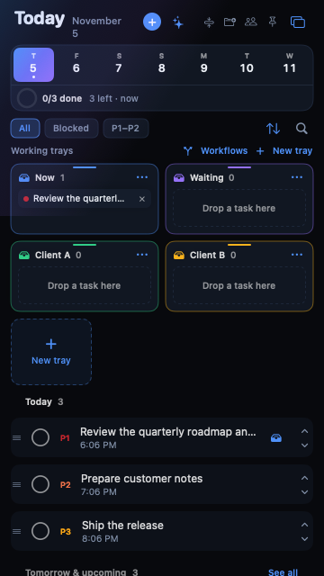
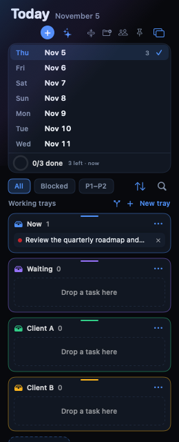

# Getting started

## 1. Create a task

- Press **⌘N** or **⌃⌥Space**, type a title, and press **Add task**.
- Or drag almost anything onto the panel: a file, folder, URL, email, Teams message, image, or Jira ticket. TodayFlow opens the capture sheet with a suggested title.

## 2. Work in trays

Trays are named staging areas below the filter row.

1. Click **New tray**, name it (“Now”, “Waiting”, “Client A”), and press **Create**.
2. Drag a task row onto a tray, or right-click the row and choose **Add to tray**.
3. Double-click a tray to open its full window.
4. Drag a chip from one tray to another to move it.

When a tray has more than three tasks, the tray column grows and scrolls with the panel at narrow widths.

### Change a tray color

Open the tray’s **…** menu → **Color**. Pick one of the named swatches, or choose **Custom color…** to open the color wheel and enter any color. The new color updates the tray card, its workflow node, and its chips.

## 3. Create a project

1. Click the **folder+** icon at the top right of Today.
2. Name the project and press **Create**.
3. The project appears in the project filter and in **Hierarchy**.
4. To put a project under an epic, open **Hierarchy**, right-click the epic, and choose **Add project**.

## 4. Keep Today on this desktop

The **anchor** button is on by default. Today stays on the current virtual desktop when you switch Spaces. Click the anchor to show Today on every desktop instead; the **View → Show Windows on All Desktops** menu stays in sync.

## 5. Squeeze the panel

- The panel can be resized down to **260 points** wide.
- Below 360 points it switches to a single-column layout: the week strip becomes a vertical day list, trays become full-width columns, and task metadata moves under the title.
- The layout shrinks element shapes and spacing rather than text; the window stops at 260 points before anything clips.

### Collapsing sections

Every section has a chevron in its header. Click it to fold that section; click again to reopen it. The week strip has a small chevron at the right of the progress row.

As you make the panel shorter, sections fold automatically from the bottom up:

1. **Done today**
2. **Tomorrow & upcoming**
3. **Working trays**
4. **The week strip**

The open **Today** list and the urgent **Overdue** list stay visible. Opening a folded section with its chevron keeps it open, even at a small height; the panel scrolls if needed.

## 6. Find the tutorials again

Open **TodayFlow → Watch Video Walkthrough** for the bundled videos, or **Help → Watch Tutorial Video**. The window has an **Overview** and a **Use cases** video; the second one is recorded from the real app and covers task creation, dragging a file, workflow setup, and a completed task moving automatically. **Help → Tutorial Index on GitHub** opens the written guides; the **Help** menu also links directly to this guide, Contacts, Jira, and Local AI.
