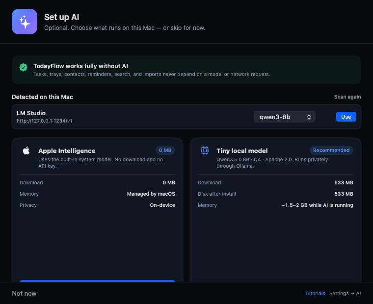

# Local AI setup

TodayFlow scans your Mac for local AI software before asking you to download anything.

## 1. Open AI setup

Use the **gear** icon in the Today header, **Settings → AI → AI setup & local models…**, or **TodayFlow → Set Up AI…**. The **sparkles** icon also opens AI actions and setup.

## 2. Detected local servers

The setup window checks localhost ports for common OpenAI-compatible servers:

| Software | Port |
| --- | ---: |
| Ollama | 11434 |
| LM Studio | 1234 |
| GPU Buddy / llama.cpp | 8080 |
| vLLM | 8000 |
| text-generation-webui | 5000 |
| Jan | 1337 |

If a server is running, its name, endpoint, and models appear under **Detected on this Mac**. Choose a model and click **Use**. No download is needed.

The scan only checks the standard ports above. If your server uses a non-standard port, open **Settings → AI → Port** and enter it; TodayFlow updates the base URL. The scan cannot discover arbitrary ports, so configure those manually.

## 3. Or download the tiny model

If no local server is running, use the **Tiny local model** card:

- **Qwen3.5 0.8B**, Q4, Apache 2.0
- **533 MB download**
- **533 MB disk**
- **~1.5–2 GB memory while AI runs**
- Runs through Ollama; Ollama adds about 665 MB if it is not already installed.

Nothing is downloaded until you press the download button.

## 4. Apple Intelligence

On supported Macs, **Apple Intelligence** uses the built-in system model with **0 MB download**.

## 5. Reconfigure later

Open **Settings → AI** to change the provider, base URL, **port**, model, timeout, or feature toggles. **Fetch models** lists what the endpoint offers. The **gear** icon in the Today header opens Settings; the **sparkles** menu also opens AI setup and settings.

**GPU Buddy:** its OpenAI-compatible proxy is on **8080** by default. A model server or another app may use 8000; that is not the proxy endpoint. Use the port shown by GPU Buddy's OpenAI API settings, or set it in TodayFlow → Settings → AI → Port.

## 6. Correct spelling and grammar

Open a task. When AI is available, a **Fix spelling & grammar** wand button appears at the top of the detail window. It corrects the title, summary, and description together while preserving names, URLs, and formatting. The feature has its own toggle in **Settings → AI**.

## 7. Use AI from the main UI

Click the **sparkles** icon in the Today header:

- **Ask about tasks…**
- **Plan my day…**
- **AI Setup & Local Models…**
- **AI Settings…**

With AI off, every core TodayFlow feature still works; AI actions show the setup prompt instead.
