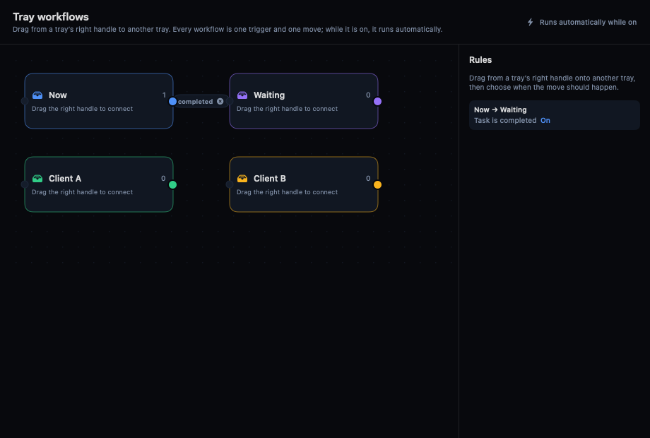

# Tray workflows

A workflow is one simple sentence:

> **When** something happens in one tray, **move** the task to another tray.

There are no branches, loops, or scripts. This keeps every workflow readable at a glance.

## Create a workflow

1. Open **Workflows** from the **Working trays** header (or **View → Workflows**).
2. Each tray is a node on the canvas.
3. Drag from the **colored circle on the right** of the source tray onto the tray that should receive the task.
4. A line is created. Its label shows the trigger (initially **completed**).
5. Click the line label or the rule in the right-hand **Rules** list.
6. Choose the trigger:
   - **Task is completed** — moves finished tasks.
   - **Due date is reached** — moves open tasks when their due date/time passes.
7. Leave **Workflow is on**. There is no Run button: while it is on, the workflow runs automatically whenever its trigger happens. Turn it off to pause the workflow.

## Example rules

| When | Move from | To |
| --- | --- | --- |
| Task is completed | Now | Review |
| Due date is reached | Waiting | Overdue |
| Task is completed | Review | Archive |

## How it runs

- Every workflow is a simple on/off switch. It runs automatically; nothing needs to be started.
- Completion rules run as soon as a task is completed.
- Due-date rules are checked every few seconds while TodayFlow is open.
- A workflow that is off is shown with a dashed line and an **off** label, and does not move anything.
- A task moves at most once per evaluation, so two rules cannot bounce it back and forth forever.
- Deleting a tray removes rules that referenced it; the editor keeps the remaining rules.
- Completed tasks stay visible in the destination tray, so an archive/done workflow is visible.

## Remove or disable a rule

Click the **×** on the line label, right-click the line label and choose **Remove workflow**, or select the rule row and choose **Delete rule**. The rule is removed immediately; tasks already moved stay where they are.
