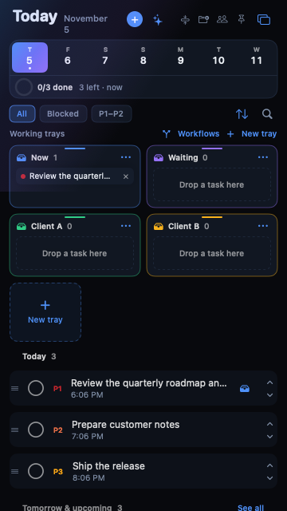

# TodayFlow tutorials

Short, screenshot-based guides for the workflows people use every day. Every image here is captured from the real TodayFlow UI.

## Start here

1. [Getting started — tasks, trays, projects, and the anchor](01-getting-started.md)
2. [Contacts — add people directly to a task and organize groups](02-contacts.md)
3. [Jira — drag tickets from the web into TodayFlow](03-jira.md)
4. [Local AI — detect Ollama, LM Studio, llama.cpp, and more](04-local-ai.md)
5. [Tray workflows — simple trigger → move rules](05-workflows.md)
6. [Video walkthrough](06-video.md)
7. [Obsidian sync](07-obsidian.md)

Watch the bundled walkthroughs from **TodayFlow → Watch Video Walkthrough** or **Help → Watch Tutorial Video**. The tutorial window includes **Overview (0:30)** and **Use cases (0:48)**; the use-cases video is recorded from the real app and shows task creation, file drag-and-drop, workflow setup, and a completed task moving between trays. You can reopen this index from **Help → Tutorial Index on GitHub** in the app menu, or from **Settings → Help**.

## Two-minute quick start

1. Press **⌃⌥Space** or **⌘N** to create a task.
2. Drag an email, file, URL, Teams message, or Jira ticket onto the panel to turn it into a task.
3. Open a task and use **Contacts → Add Contact** to link a person.
4. Click the **folder+** icon to create a project.
5. Click the **sparkles** icon for AI actions and local model setup.
6. Add tags to tasks and projects; use the tag icon in the filter row to narrow Today.
7. Connect an Obsidian vault in **Settings → Obsidian** for optional two-way task sync and note deep links — locally, through iCloud, or to a remote Obsidian via the Local REST API plugin.

## Keeping the panel on one desktop

The **anchor** button keeps Today on its current virtual desktop. Click it again to show Today on all desktops.
